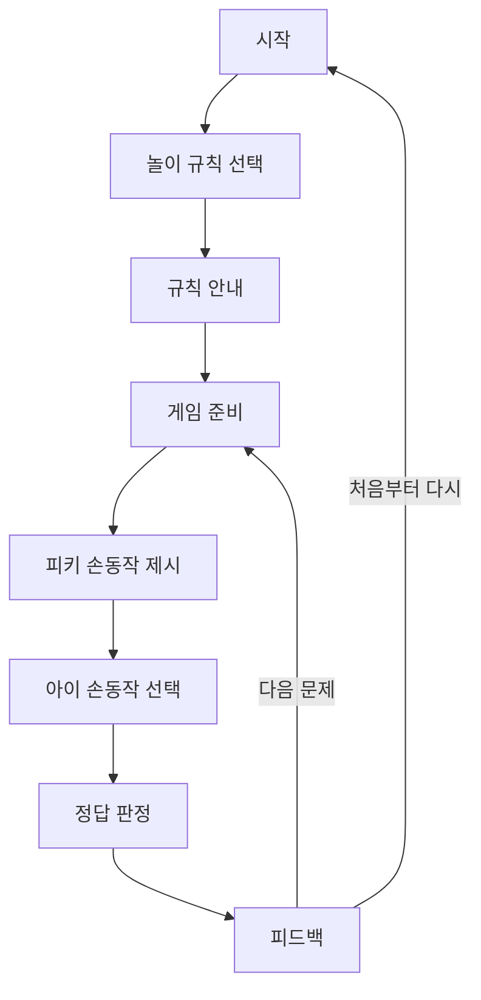

# 사용자 흐름

## 예외 흐름

- 아무것도 고르지 않음: 버튼을 누르지 않은 상태로 유지하고, 필요하면 `noSelection` 문구를 사용합니다. 현재 버튼 입력은 선택 전 제출이 불가능합니다.
- 같은 버튼을 연속으로 누름: 결과가 확정된 `RESULT` 단계에서는 입력을 비활성화하고 reducer가 추가 제출을 무시합니다.
- 결과 화면에서 다시 누름: `다음 문제`만 허용합니다. 성공 기록은 유지됩니다.
- 놀이 도중 규칙 변경: 현재 1차 UI에서는 결과/라운드 흐름을 벗어나 임의로 변경하지 않도록 시작 화면에서만 모드를 고릅니다. 이후 모드 변경 버튼을 추가할 때는 현재 라운드를 폐기하고 `INSTRUCTION`으로 이동시키면 됩니다.
- 처음부터 다시 시작: `RESTART`가 모드, 라운드, 결과, 성공 횟수를 모두 초기화합니다.
- 향후 AI 인식 실패: AI 어댑터가 입력을 만들지 않고 재인식 안내를 보여줍니다. 현재는 카메라/API를 연결하지 않았습니다.
